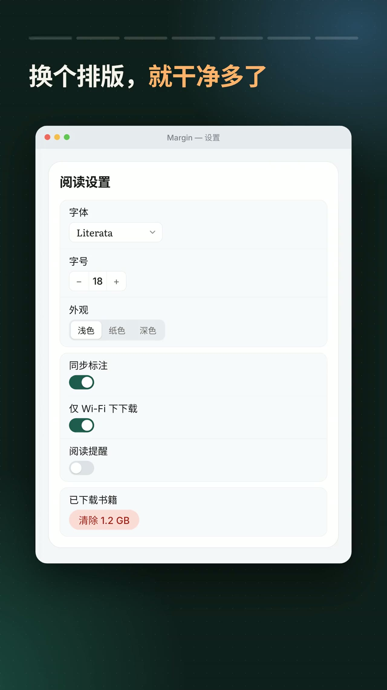
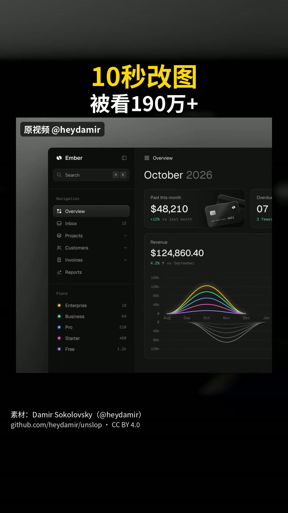
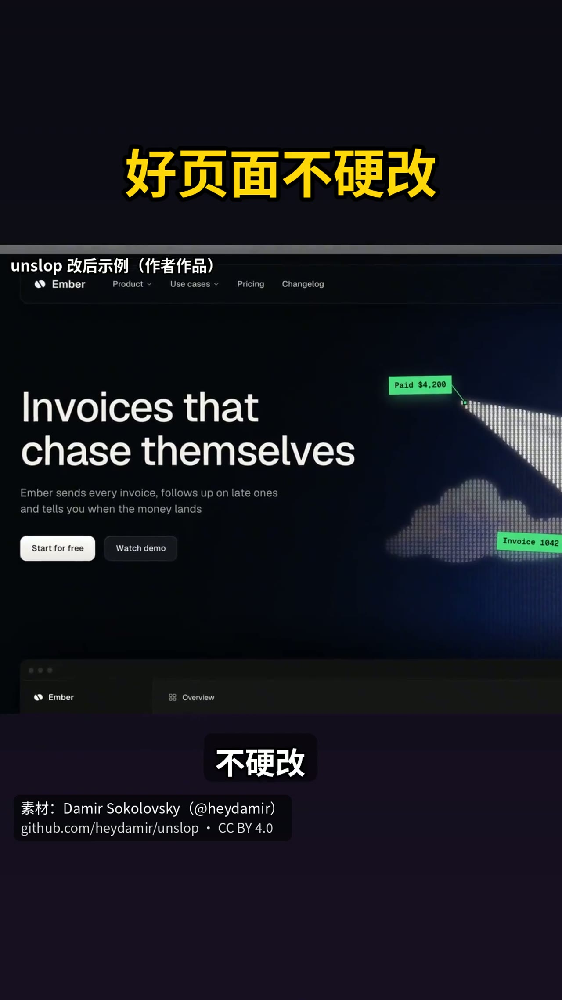
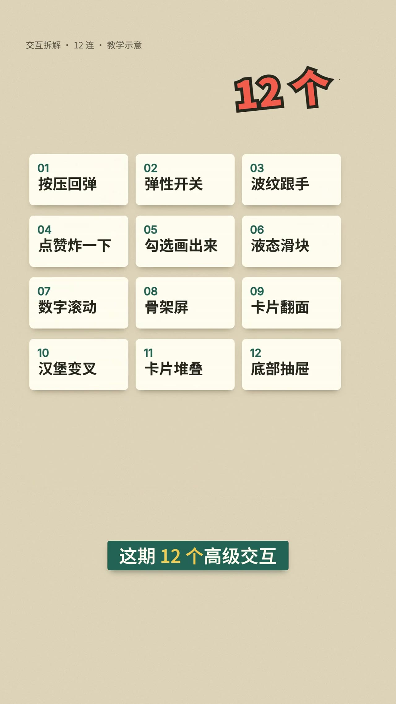

# 抖音「去 AI 味 / UI 细节」5 条视频精读

> 调研日期：2026-11-07 ｜ 方法：逐条下载原始视频 → 每 4 秒抽一帧 → 本地 Paraformer 转写 → 逐帧看图核对字幕
> 工具：本机 DSH 的 `video_read`（dsh-video-kit + 抖音 CDP 抓取改造）
> 说明：字幕经 ASR，个别专有名词有误（视频里说 `unslop`，转写成 "nslop/onslop"；"控件"转成"控键"；"贝塞尔"转成"贝塔二"），下文已按画面与仓库地址校正。

---

## 一、五条视频速览

| # | 作者 | 标题 | 时长 | 一句话结论 |
|---|---|---|---|---|
| 1 | 费纸张 | AI 做的设置页太乱？三步排版清楚 | 44s | 设置页只需要「名称左 / 控件右 / 一行一项 / 去掉外层卡 / 分组加标题」，表单场景例外改上下排 |
| 2 | 费纸张 | 四条规则去掉设计里的 AI 味儿 | 32s | 配色、间距圆角档位、左对齐、删装饰——四条可写进提示词，让 AI 一次做对 |
| 3 | 诸葛瑾的 AI 日记 | 10 秒改图被看 190 万次，设计师把去 AI 味方法开源 | 72s | 海外设计师 heydamir 的 `unslop` skill：`/unslop` + 页面，九轮从间距改到动效 |
| 4 | CoverAI | 先看这两个按钮，你更想点哪个？ | 140s | 12 个微交互拆到「名字 + 一句提示词」，可直接喂给 AI 生成 |
| 5 | 设计师 PPM | 动效丝滑的关键就是要懂运动曲线 | 90s | 五类曲线（线性/缓入/缓出/缓入缓出/自定义）各有固定使用场景 |

**共同点**：五条都不谈"风格"，只谈**可判定的规则**——颜色用几个、间距取哪几档、动效该快还是该慢。

---

## 二、逐条精读

### 1｜费纸张：AI 做的设置页太乱？三步排版清楚（44s）

原链接 `https://v.douyin.com/M0_ELGfOz24/` ｜ 视频 ID `7702873595030113576`

**演示对象**：一个叫 `Margin` 的阅读 App 的设置页。

**改造前**：每个设置项都是「标签在上、控件在下」的小卡片，整页套在一个大圆角卡片里，三层边框叠着，视觉上到处是框。



**三步**：

1. **名称放左边，控件放右边，一行一个设置项**（00:05）
   左边找名字、右边看选项，眼睛只横向扫一次。
2. **去掉最外面那层框**（00:13）
   页面本身不需要再套一层卡片；框少了，层次感反而出来。
3. **每个组加标题，组间多留白、组内少留白**（00:19）
   分组标题（阅读 / 同步与下载 / 存储）+ 组内用细线分隔；**删除类操作单独放一组**（"清除 1.2 GB" 独立成块，避免误触）。


**作者自己补的例外**（这点比三步更值钱）：
- **表单场景要上下排**：用户是「按顺序填写」的，左右排会把输入框挤窄，错误提示也只能挤在半列里（00:25）
- 结论一句话：**"小控件、独立保存的设置 → 左右排；有顺序的表单 → 上下排"**（00:39）

---

### 2｜费纸张：四条规则去掉设计里的 AI 味儿（32s）

原链接 `https://v.douyin.com/iLRcCMf78W8/` ｜ 视频 ID `7703624707744091446`

**演示对象**：一张典型的"AI 生成定价卡"——渐变、发光、🚀、🔥人气之选、绿色对勾、感叹号、惊叹号堆满。


**四条规则**（画面里的编号与字幕一致）：

| # | 规则 | 具体做法（画面证据） |
|---|---|---|
| 1 | **控制配色** | 底色和文字全部用中性色（黑白灰），**靠明暗对比突出主要操作**；不用渐变、不用发光 |
| 2 | **统一设计变量** | 间距只用 **4 / 8 / 12 / 16 / 24 / 32** 六档，圆角只用 **6 / 10 / 16** 三档；组内紧凑、组间留白 |
| 3 | **左边缘对齐** | 同一列元素（标题、价格、卖点、按钮）左边缘对齐，形成一条隐形的线 |
| 4 | **删掉多余装饰** | 统一一套线性图标；删掉表情符号、感叹号、装饰徽章（"🔥人气之选"、"专业套餐🚀" → "专业版"） |


**收尾主张**（00:27）：把这四条**写进提示词**，让 AI 从一开始就做成这样，而不是生成完再返修。

> 一个值得记的细节：作者自己的"改造后"版本里，按钮上仍留着 🚀、年付 tab 上仍留着 🎉。说明这不是"零 emoji"的洁癖，而是**装饰要有配额**——全部砍掉的是「徽章 + 感叹号 + 满屏图标」这类噪音。

---

### 3｜诸葛瑾的 AI 日记：10 秒改图被看 190 万次（72s）

原链接 `https://v.douyin.com/qFNn3n1tNRo/` ｜ 视频 ID `7703543180775460139`

**它是什么**：海外设计师 **Damir Sokolovsky（@heydamir）** 把方法开源成 `unslop`
- 仓库：`github.com/heydamir/unslop`（视频标注 CC BY 4.0）
- **不是网站**，是装进 Claude Code / Codex 里的一个 skill
- 用法：输入 `/unslop` → 说明要改哪个页面

**工作流程**（00:33–00:45）：
1. **先挑毛病**：把渐变、发光、表情符号、喊口号的文案一条条标出来
2. **按你的产品定风格**：不是套模板，是看产品该长什么样
3. **从间距、颜色一路改到动效，一共九轮**





**具体改动例子**：
- "欢迎回来 👋" → 直接写月份
- "涨了 12%!!" → "较上月涨 12%"
- 彩虹渐变曲线图 → 单色、克制的图表；整页只保留一处绿色（`Paid $4,200` 标签）

**边界（我认为最该学的一条）**：页面本来就不错的话，**他会直说"不应该改"**（00:55）。工具的价值是判断，不是无脑重做。

**数据**：仓库上线几天涨 5000+ star；门槛是得会用 AI 编程工具。

---

### 4｜CoverAI：12 个高级交互，每个配一句提示词（140s）

原链接 `https://v.douyin.com/H3Uwh4WUWO0/` ｜ 视频 ID `7702307466616292543`

**开场钩子**：两个按钮都按一下，你更想点哪个——差别是「按压回弹」，多数人感觉得到但叫不出名字。



| # | 名字 | 正确做法 | 常见错误 |
|---|---|---|---|
| 01 | 按压回弹 | 按下缩一点，松手**先弹到比原尺寸略大再回落** | 只缩不回，像按在一张纸上 |
| 02 | 弹性开关 | 圆点跑向另一头时**先拉成小胶囊**，到位再缩回圆形 | 圆点直接平移，没有重量感 |
| 03 | 波纹跟手 | 波纹从**手指按下的位置**扩散 | 不管按哪儿都从正中散开 |
| 04 | 点赞炸一下 | 点赞/收藏值得放一朵小烟花 | 每个按钮都炸，吵 |
| 05 | 勾选画出来 | 勾**一笔画**出来（左下 → 右上） | 勾突然出现 |
| 06 | 液态滑块 | 轨道颜色、圆钮、数字**三样一起走** | 谁慢半拍都显得松 |
| 07 | 数字滚动 | 结束前**减速**停下 | 跑着跑着急刹车，像卡了 |
| 08 | 骨架屏 | 灰块**高度与真实内容一致**，数据来了直接填进去 | 加载完页面跳一下 |
| 09 | 卡片翻面 | 翻到一半时**背面文字不能透出来**，更不能是反的 | 翻面穿帮 |
| 10 | 汉堡变叉 | 还是那三条线自己挪成叉 | 换了一个图标，失去"同一个按钮"的认知 |
| 11 | 卡片堆叠 | 最上面那张划走后，**后面那张露出一条边** | 划走就没了，用户不知道底下还有 |
| 12 | 底部抽屉 | 拉上来**先在半程停一下**，让人看清内容再决定拉满或关掉 | 一拉到底，没法反悔 |

**用法主张**（02:06）：12 句提示词都在视频里，"截个图，下次让 AI 做 App 的时候一起发给他"——**把交互细节也变成提示词资产**。

---

### 5｜设计师 PPM：五类运动曲线（90s）

原链接 `https://v.douyin.com/UvBZlMhnlzI/` ｜ 视频 ID `7675710487983639859`

| 曲线 | 特征 | 该用在哪 | 用错的后果 |
|---|---|---|---|
| **线性 linear** | 全程同速，无加减速 | 加载旋转等恒定速度动画 | 用在界面元素上会显得机械 |
| **缓入 ease-in** | 先慢后快 | 元素**离场**：弹窗关闭、浮层消失、页面退出 | 离场拖沓 |
| **缓出 ease-out** | 先快后慢，自然停下 | 元素**进场**：弹窗出现、抽屉划入、卡片进入 | 进场生硬 |
| **缓入缓出 ease-in-out** | 起慢—中快—末慢 | 页面内位移、模块展开收起、页面切换 | 距离短时显得"肉" |
| **自定义贝塞尔** | 前四种都是它的预设 | 建立产品统一的动效节奏 / 品牌辨识度 | 每个组件各写一条，节奏散 |


**关键判断**：曲线不是审美问题，是**方向问题**——进场用缓出（快给反馈、慢落地），离场用缓入（慢慢走开）。

---

## 三、横向对比：三条内容其实是一套方法

### 共识（五条视频反复出现的同一批判断）
1. **颜色做减法**：中性色打底 + 一处强调色（费纸张的"明暗对比"、unslop 的"只留一个绿色"）
2. **变量做成档位**：间距/圆角/曲线都从固定集合里取，不自由发挥
3. **靠对齐和留白建立秩序**：左边缘对齐、组内紧凑组间留白——两个作者说的几乎是同一句话
4. **动效必须有物理依据**：回弹、跟手、减速，都是"像真东西"

### 两种路线
| | 路线 | 代表 | 适合 |
|---|---|---|---|
| A | **事前规训**：把规则写进提示词，让 AI 第一次就做对 | 费纸张（四条规则）、CoverAI（12 句提示词） | 自己写提示词生成页面的场景 |
| B | **事后返修**：生成完再按方法体检、判断、改 | unslop（九轮体检） | 已有页面 / 别人的设计稿 |

两者不冲突：A 是降低返修率，B 是兜底。unslop 那条"好页面会直说不需要改"提醒我们——**B 的核心是判断力，不是改动力**。

### 一个值得警惕的点
费纸张给的是"通用规则"，unslop 强调的是"按你的产品定风格"。规则能立刻落地，但**只靠规则会做出"干净但没有个性"的页面**——这正是 AI 味的下一个阶段。真正的解是：**规则管噪音，风格管识别度**。

---

## 四、可直接落到我们项目的东西

### 1）设计令牌（照抄费纸张的档位）
```css
--space-1: 4px;  --space-2: 8px;  --space-3: 12px;
--space-4: 16px; --space-5: 24px; --space-6: 32px;
--radius-sm: 6px; --radius-md: 10px; --radius-lg: 16px;
```
- 组内用 `--space-1/2`，组间用 `--space-5/6`
- 同一列所有元素左边缘对齐（用 grid 而不是逐个 margin 调）

### 2）设置页排版规则
- 默认：`label` 左、控件右，一行一项
- 分组 + 组标题；组间留白 > 组内留白
- **破坏性操作单独成组**（清除缓存、退出登录、删除账号）
- 例外：**有顺序的表单一律上下排**

### 3）动效常量（照抄五类曲线的场景分工）
```css
--ease-out: cubic-bezier(0.16, 1, 0.3, 1);   /* 进场 */
--ease-in: cubic-bezier(0.7, 0, 0.84, 0);    /* 离场 */
--ease-in-out: cubic-bezier(0.65, 0, 0.35, 1); /* 位移/展开 */
--dur-fast: 120ms; --dur-base: 200ms; --dur-slow: 300ms;
```

### 4）提示词模板（费纸张 + CoverAI 的合并版）
```
按以下约束生成界面：
- 配色：中性底色与文字，只用一个强调色；禁止渐变、发光、多重阴影
- 变量：间距只用 4/8/12/16/24/32，圆角只用 6/10/16；组内紧凑、组间留白
- 对齐：同一列元素左边缘对齐
- 装饰：一套线性图标；不用 emoji、不用感叹号、不用装饰徽章
- 动效：进场 ease-out 200ms，离场 ease-in 150ms，位移 ease-in-out 250ms
- 设置项：名称左、控件右、一行一项；破坏性操作单独成组
```

---

## 五、逐字稿（校对后节选）

<details>
<summary>1. 费纸张 · 三步排版（44s）</summary>

```
[00:00] 应用的设置页面换个排版就干净多了
[00:03] 只需要三个步骤
[00:05] 第一 名称放左边 控件放右边 一行一个设置项
[00:13] 第二 去掉最外面那层框 页面不用再套一层卡片
[00:19] 第三 给每个组加上标题 组间多留白 组内少留白
[00:23] 删除操作单独放
[00:25] 但是表单场景要注意 用户按顺序填写 左右排会挤窄输入框 错误提示也得挤在半列里
[00:33] 把名称放上面就清楚了
[00:36] 小控件、单独保存的设置左右排
[00:39] 顺序填写的表单上下排
```
</details>

<details>
<summary>2. 费纸张 · 四条规则（32s）</summary>

```
[00:00] 四条规则去掉设计里的 AI 味儿
[00:03] 一 控制配色：底色和文字用中性色，用明暗对比突出主要操作，不用渐变也不发光
[00:11] 二 统一设计变量：间距和圆角只用固定档位，组内紧凑组间留白
[00:18] 三 同一列元素左边缘对齐
[00:20] 四 删掉多余装饰：统一使用一套线性图标，删掉表情符号、感叹号和装饰徽章
[00:27] 把这四条规则写进提示词，让 AI 从一开始就做成这样
```
</details>

<details>
<summary>3. 诸葛瑾的 AI 日记 · unslop（72s）</summary>

```
[00:00] 紫色渐变、满屏发光、表情符号当图标——这种网页一看就是 AI 做的
[00:07] 国外设计师 Damir 专治这个
[00:09] 拍一条十秒的改图视频，在海外社交平台上被看了一百九十多万次
[00:17] 后来他把方法开源了，名字叫 unslop，大意就是"去 AI 味"
[00:23] 先说清楚，他不是网站，是装进 Claude Code 或 Codex 里的一个技能
[00:28] 输入 /unslop，再说要改哪个页面就行
[00:33] 他先挑毛病：渐变、发光、表情符号、喊口号的文案，一条条标出来
[00:38] 再按你的产品定风格，从间距、颜色一路改到动效，一共九轮
[00:46] "欢迎回来 👋"变成直接写月份；"涨 12%!!"变成"较上月涨 12%"
[00:54] 页面本来就不错的话，他会直说"不应该改"
[00:57] 仓库上线几天就涨了五千多星，门槛是得会用 AI 编程工具
```
</details>

<details>
<summary>4. CoverAI · 12 个高级交互（140s）</summary>

```
[00:00] 先看这两个按钮，都按一下，你更想点哪个
[00:04] 选了右边的说明你已经感觉到差别了，只是可能叫不出它的名字
[00:08] 这期十二个高级交互，每个都告诉你叫什么，再配一句提示词
[00:16] 01 按压回弹：按下缩一点，松手先弹得比原来稍大，再落回原样
[00:27] 02 弹性开关：圆点跑向另一头时先被拉成小胶囊，到位再缩回原形
[00:37] 03 波纹跟手：按在左边，波纹就从左边起
[00:48] 04 点赞炸一下：值得放一朵小烟花，但别每个按钮都炸
[00:58] 05 勾选画出来：一笔从左下拉到右上
[01:06] 06 液态滑块：轨道颜色、圆钮、数字三样一起走
[01:16] 07 数字滚动：快结束时要慢慢减速停下
[01:24] 08 骨架屏：灰块要跟真实内容一样高，数据来了直接填进去
[01:33] 09 卡片翻面：翻到一半时背面的字不能透过来
[01:41] 10 汉堡变叉：三条横线自己挪成一个叉
[01:49] 11 卡片堆叠：划走以后后面那张要露出一条边
[01:58] 12 底部抽屉：拉上来先在半程停一下
[02:06] 十二句提示词都在视频里了，截图，下次让 AI 做 App 的时候一起发给他
```
</details>

<details>
<summary>5. 设计师 PPM · 五类运动曲线（90s）</summary>

```
[00:00] 微动效无论你用设计软件还是 AI 工具，都要了解运动曲线才能做出丝滑的动画
[00:05] 今天介绍 UI 动效中常见的五类运动曲线
[00:09] 一 线性曲线：从开始到结束保持相同速度，没有加速也没有减速，看起来比较机械，
      更适合加载旋转这类恒定速度的动画
[00:20] 二 缓入曲线：先慢后快，常用于元素离开页面——弹窗关闭、浮层消失、页面退出
[00:33] 三 缓出：开始很快，接近终点逐渐减速，最后自然停下；可以快速给出反馈又有平稳落地感，
      常用于弹窗出现、抽屉划入、卡片和组件进入页面
[00:50] 四 缓入缓出：开始慢、中间加速、接近终点再次减速，整个运动过程被完整展示，
      适合元素在页面内从一处移动到另一处，以及模块展开收起和页面切换
[01:06] 五 自定义贝塞尔曲线：前面几种本身就是预设好的贝塞尔，自定义可以细致调整
      什么时候加速、什么时候减速、以及停下来的感觉，适合建立统一动效节奏或品牌辨识度
```
</details>

---

## 六、方法与局限

- **数据来源**：抖音 App 分享的 5 条短链，解析成 `www.douyin.com/video/<id>` 后抓取原始流（短视频为单条 mp4，长视频为 DASH 音视频分离）
- **转写**：本地 sherpa-onnx Paraformer（中文），无云端调用；90 秒音频约 20 秒转完
- **抽帧**：每 4 秒一帧，1280 宽，共 11–14 帧/条
- **已知误差**：
  - ASR 对专有名词不稳定（`unslop` / 控件 / 贝塞尔），本文件已按画面修正
  - 视频里出现但没念出来的信息（如规则 3 的编号、unslop 的仓库地址）来自画面文字
  - 未采集：点赞/评论数、作者主页、同系列其他视频