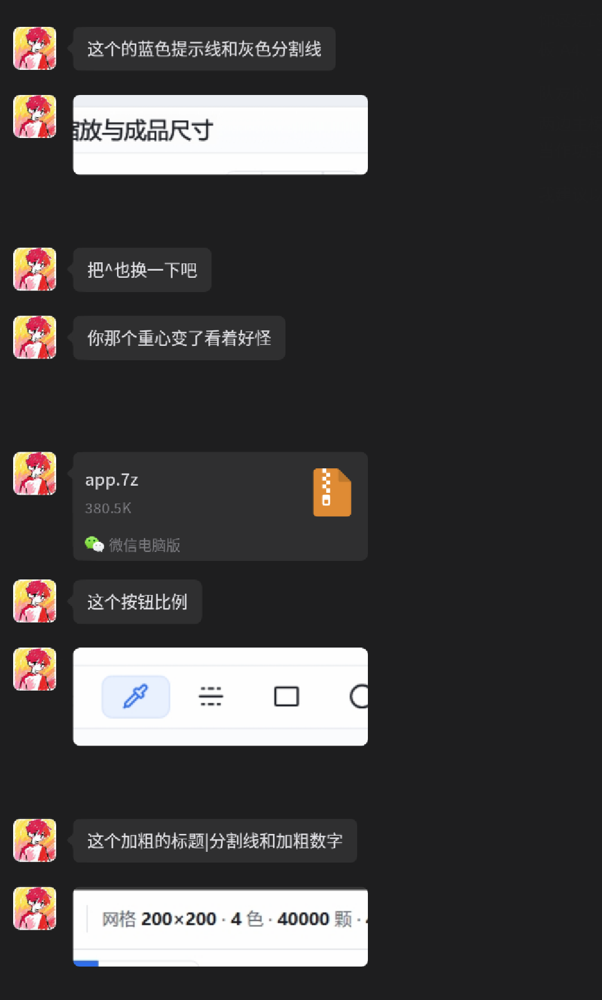
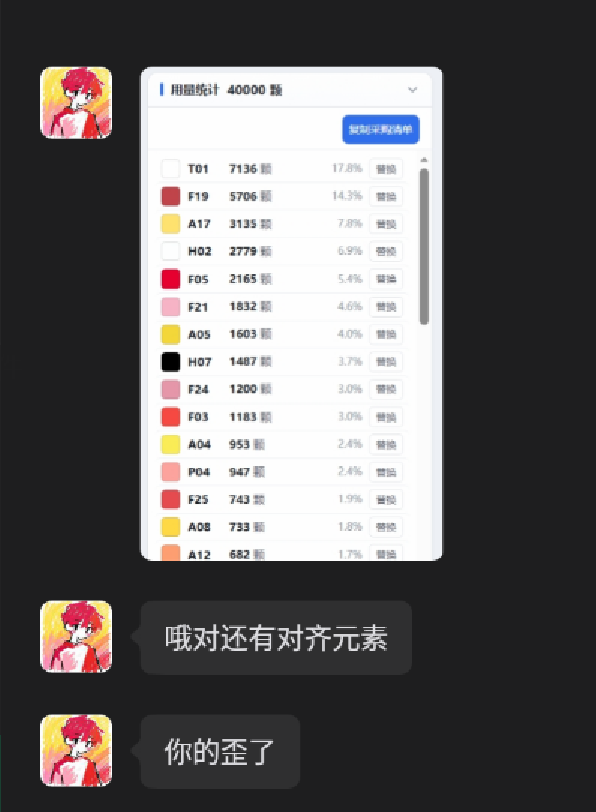
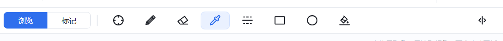
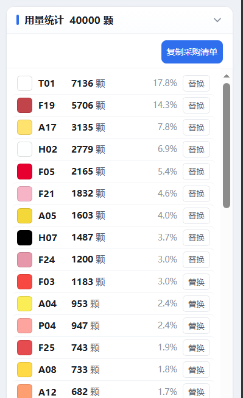

# 拼豆图纸工具会话记录

记录日期：2026-11-07  
时区：Asia/Shanghai  
工作目录：`/home/liutingqiu/hackone`

## 会话目标

- 对比远端最新提交与队友本地版本 `hbb/`。
- 整理两个版本的功能状态、融合相关信息，以及手机端 / App 封装相关情况。
- 阅读队友微信截图中的界面反馈。

## 时间与赛事信息

- 本会话核对的系统时间为 **2026-11-07 22:00 CST**。
- 前序记录中提到：2026-11-07 19:12，队内询问手机项目是否可以提交 APK；19:16，主办方回复可以。
- 前序记录中提到：主办方将在 **2026-11-08 10:00** 发提交入口。
- 用户指出查找队友微信要求应聚焦 2026-11-07 晚间记录，不应拿凌晨记录代替。

## Git 与版本记录

### 远端最新四个提交

| 顺序 | 提交 | 作者 | 时间（CST） | 内容 |
| --- | --- | --- | --- | --- |
| 1（最新） | `e0120f7` | `SShaner0903` | 2026-11-07 21:44:54 | 归档 v2.1 快照 |
| 2 | `2117cf8` | `SShaner0903` | 2026-11-07 21:42:52 | 归档 v2.0 快照 |
| 3 | `694bac5` | `SShaner0903` | 2026-11-07 21:39:40 | 归档 v1.1 快照 |
| 4 | `8009032` | `liutingqiu` | 2026-11-07 20:13:09 | 增加 v1.0 至 v1.3.1 发布说明 |

- `8009032` 改动文件：`README.md`、`docs/RELEASE-NOTES.md`。
- 用户最近的功能提交为 `4dd8817`，主题是撤销操作不再清空拼装进度。
- 工作区状态：`main` 比 `origin/main` 落后 3 个提交；`hbb/` 为未跟踪目录。
- 本会话中没有合并或修改项目源码。

### 版本文件

- 队友目录：`/home/liutingqiu/hackone/hbb/`
- `hbb/app/app_template.html` 和生成的 HTML 与远端 `2.1/` 快照对应文件一致。
- 当时统计的模板行数：主线 `app/app_template.html` 4115 行；`hbb/app/app_template.html` 2929 行。
- 两个主模板的差异约为 728 行新增、1914 行删除（相对主线比较）。

## 功能与移动端信息

### 主线 v1.3.1

- 单文件 HTML 前端；色板数据由 `app/build_html.py` 注入模板生成。
- 功能记录涉及图片转拼豆图纸、画布编辑、撤销/重做、拼装进度、多画布、A4 分板图、PNG / CSV 导出、采购清单、分享链接。
- v1.3 将“查看”和“标记”作为工具处理，取消独立的“浏览 / 标记”模式切换。
- v1.3.1 修复撤销时拼装进度被清空的问题。
- 发布说明中记录的已知问题包括移动端平移手势未专门适配。

### `hbb/` / v2.1

- 包含卡片式分组、可折叠区块、步进控件和新版工具栏样式。
- 其进度实现可见于 `hbb/app/app_template.html` 的 `syncProgress()`、`saveProgress()` 等函数。
- 当前目录中的模板与远端 `2.1/` 归档模板相同。

### 手机适配测试记录

- `docs/user-testing/retest-2026-11-07-1320.md` 记录了 390px 手机视口下新导入图纸可完整显示、纵向滚动正常。
- 同一记录报告：桌面缩放后保存的草稿在 390px 视口恢复时会被裁切，需要横向滚动。
- 主线画布平移使用 Pointer Events；画布编辑代码仍有 `mousedown` / `mousemove` 事件处理。
- 已检查的主线文件清单中没有 PWA `manifest.json`、Service Worker 或 Capacitor 配置。

### 本机 Android 相关环境（核对时）

| 项目 | 状态 |
| --- | --- |
| Node.js | `v22.23.4` |
| Java | `25.0.4.1` |
| `adb` | 存在：`/usr/bin/adb` |
| `ANDROID_HOME` | 未设置 |
| `ANDROID_SDK_ROOT` | 未设置 |
| `sdkmanager` | 未找到 |

### 前序答复中的工时估算

以下是会话中的估算记录，不代表已实施或实际耗时：

- 手机网页 / PWA：约 4–7 小时。
- Android APK：约 6–10 小时，包含环境准备、封装、构建和设备验证。
- 前序讨论提到赛事接受 APK；会话中没有确认 APK 是必交项。

## 队友微信截图中的界面反馈

截图中可读到的文字反馈：

- “这个的蓝色提示线和灰色分割线”
- “把也换一下吧”
- “你那个重心变了看着好怪”
- “这个按钮比例”
- “这个加粗的标题分割线和加粗数字”
- “哦对还有对齐元素”
- “你的歪了”

截图对应的界面元素包括：

- “缩放与成品尺寸”分组标题及折叠箭头。
- 顶部工具栏中的“浏览 / 标记”分段按钮及绘图工具图标。
- 显示“网格 200×200、4 色、40000 颗、49 块板”的状态栏。
- “用量统计 40000 颗”列表；每行包含色块、色号、颗数、百分比和“替换”按钮。
- 微信电脑版收到名为 `app.7z`、大小显示为 `380.5K` 的压缩文件卡片。

### 图片记录

## 会话中提及的文件与链接

- [发布说明](/home/liutingqiu/hackone/docs/RELEASE-NOTES.md)
- [手机端复测记录](/home/liutingqiu/hackone/docs/user-testing/retest-2026-11-07-1320.md)
- [移动端与 Android 预检清单](/home/liutingqiu/hackone/docs/preflight.md)
- [主线 HTML 模板](/home/liutingqiu/hackone/app/app_template.html)
- [队友 HTML 模板](/home/liutingqiu/hackone/hbb/app/app_template.html)
- [项目线上地址](https://hack.liutingqiu.xyz)
- [Capacitor Android 环境配置文档](https://capacitorjs.com/docs/getting-started/environment-setup)
